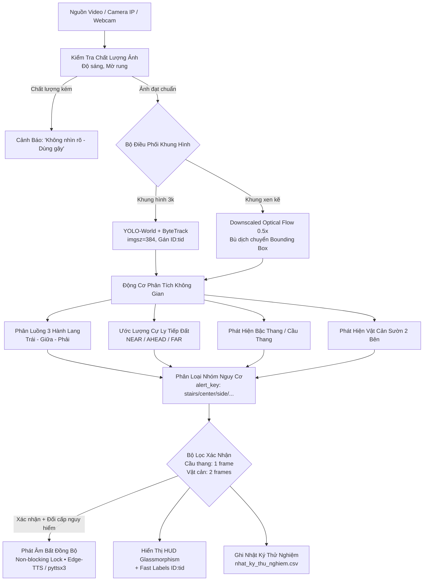

# 🦯 Trợ Lý Thị Giác AI Hỗ Trợ Người Khiếm Thị
### *AI Vision Assistant for the Visually Impaired (2026 Production Edition)*

[](https://www.python.org/)
[](https://docs.ultralytics.com/models/yolo-world/)
[](https://pytorch.org/)
[](https://opencv.org/)
[](https://github.com/rany2/edge-tts)
[](#-12-bản-quyền--giấy-phép)

---

## 📑 Mục Lục
1. [Giới Thiệu Dự Án & Ý Nghĩa Thực Tiễn](#-1-giới-thiệu-dự-án--ý-nghĩa-thực-tiễn)
2. [Nguyên Tắc An Toàn Cốt Lõi (Safety First)](#-2-nguyên-tắc-an-toàn-cốt-lõi-safety-first)
3. [Đột Phá Công Nghệ & Giải Thuật](#-3-đột-phá-công-nghệ--giải-thuật)
   - [3.1. Nhận diện vật thể mở với YOLO-World](#31-nhận-diện-vật-thể-mở-open-vocabulary-với-yolo-world)
   - [3.2. Bộ bám vết lai Downscaled Optical Flow + ByteTrack](#32-bộ-bám-vết-lai-downscaled-optical-flow--bytetrack)
   - [3.3. Tự động kiểm định chất lượng thị giác](#33-tự-động-kiểm-định-chất-lượng-thị-giác-image-quality-assessment)
   - [3.4. Phân làn 3 hành lang & Ước lượng cự ly tiếp đất](#34-phân-làn-3-hành-lang--ước-lượng-cự-ly-tiếp-đất-foot-ratio)
   - [3.5. Cảnh báo sườn & Phân loại nguy cơ](#35-cảnh-báo-sườn-side-obstacle--phân-loại-nguy-cơ)
   - [3.6. Âm thanh bất đồng bộ không chặn luồng Camera](#36-âm-thanh-bất-đồng-bộ-không-chặn-luồng-camera-non-blocking-tts)
   - [3.7. Giao diện trực quan Glassmorphism HUD](#37-giao-diện-trực-quan-glassmorphism-hud)
4. [Sơ Đồ Kiến Trúc Hệ Thống (Architecture Flowchart)](#-4-sơ-đồ-kiến-trúc-hệ-thống)
5. [Thông Số Kỹ Thuật & Cấu Hình Cốt Lõi](#-5-thông-số-kỹ-thuật--cấu-hình-cốt-lõi)
6. [Yêu Cầu Hệ Thống & Hướng Dẫn Cài Đặt](#-6-yêu-cầu-hệ-thống--hướng-dẫn-cài-đặt)
7. [Hướng Dẫn Sử Dụng & Kết Nối Nguồn Camera](#-7-hướng-dẫn-sử-dụng--kết-nối-nguồn-camera)
8. [Bảng Phím Tắt Thao Tác Hiện Trường](#-8-bảng-phím-tắt-thao-tác-hiện-trường)
9. [Cấu Trúc Nhật Ký Kiểm Thử CSV](#-9-cấu-trúc-nhật-ký-kiểm-thử-csv)
10. [Cấu Trúc Thư Mục Dự Án](#-10-cấu-trúc-thư-mục-dự-án)
11. [Xử Lý Lỗi Thường Gặp (Troubleshooting)](#-11-xử-lý-lỗi-thường-gặp-troubleshooting)
12. [Bản Quyền & Tuyên Bố Miễn Trừ Trách Nhiệm](#-12-bản-quyền--giấy-phép)

---

## 📖 1. Giới Thiệu Dự Án & Ý Nghĩa Thực Tiễn

**Trợ Lý Thị Giác AI** là hệ thống thị giác máy tính và học sâu biên (Edge AI) thời gian thực, được thiết kế chuyên biệt để hỗ trợ định hướng không gian và phát hiện vật cản từ xa cho người khiếm thị.

Người khiếm thị gặp vô vàn thách thức khi di chuyển trong đời sống thực tế: va quẹt cột điện, vấp ngã tại bậc thềm/cầu thang, quẹt người/tường ở hai bên sườn. Trong khi **gậy dẫn đường (White Cane)** truyền thống chỉ phát hiện được các vật thể ở sát mặt đất trong bán kính dưới 1 mét, hệ thống AI đóng vai trò như một **"đôi mắt phụ quan sát sớm"** từ 2 đến 5 mét, giúp người dùng chủ động phòng ngừa nguy cơ trước khi bước tới.

---

## 🛡️ 2. Nguyên Tắc An Toàn Cốt Lõi (Safety First)

> [!IMPORTANT]
> **TIÊU CHUẨN AN TOÀN Y SINH HỌC & ĐỊNH HƯỚNG DI CHUYỂN:**
> 1. **Bắt buộc luôn dùng gậy dẫn đường:** AI là công cụ hỗ trợ bổ trợ nhận biết từ xa; người sử dụng **luôn luôn phải sử dụng gậy dẫn đường** để rà soát mặt đất thực tế trước mỗi bước chân.
> 2. **Tuyệt đối không tự ý ra lệnh rẽ:** Hệ thống **không bao giờ phát lệnh "hãy rẽ trái" hay "hãy rẽ phải"** vì camera chưa thể xác minh bề mặt bên rẽ có hố sâu, trơn trượt hay nắp cống hỏng hay không.
> 3. **Chỉ thông báo trạng thái quan sát:** Hệ thống thông tin trung thực: *"Làn giữa có vật cản, hai bên chưa phát hiện vật cản"*, kèm mệnh lệnh bảo vệ: *"Hãy dừng lại, dùng gậy kiểm tra"*.

---

## 🚀 3. Đột Phá Công Nghệ & Giải Thuật

### 3.1. Nhận diện vật thể mở (Open-Vocabulary) với YOLO-World
- Tích hợp mô hình nhận diện thế hệ mới **YOLO-World (v8s)** với tập 23 nhãn mở chuyên biệt cho giao thông và học đường:
  `cabinet`, `electric box`, `obstacle`, `barrier`, `fence`, `box`, `barrel`, `sign`, `person`, `vehicle`, `wall`, `pillar`, `chair`, `table`, `desk`, `door`, `stairs`, `steps`, `backpack`, `trash can`, `utility pole`, `electric pole`, `streetlight pole`.
- **Khắc phục triệt để điểm mù Cột điện mảnh**:
  - Bình thường, cột điện/cột đèn có thân cao nhưng hẹp ngang, diện tích hộp bao pixel rất nhỏ nên dễ bị bộ lọc diện tích loại bỏ.
  - Dự án thiết lập bộ lọc riêng: `min_area_ratio = 0.0003` (chỉ 0.03% diện tích ảnh) và hạ ngưỡng tin cậy xác nhận `conf >= 0.28`, giúp bắt dính cột điện từ xa.

### 3.2. Bộ bám vết lai (Downscaled Optical Flow + ByteTrack)
- **Chu kỳ suy luận tiết kiệm tài nguyên (`DETECT_EVERY = 3`)**: Chạy suy luận nơ-ron kết hợp **ByteTrack** định kỳ mỗi 3 khung hình (`imgsz=384`, `conf=0.18`, `iou=0.40`), cấp phát mã định danh duy nhất (`Track ID`) cho từng chướng ngại vật.
- **Luồng quang học hạ độ phân giải 50% (`flow_scale = 0.5`)**:
  - Các khung hình xen kẽ được thu nhỏ bằng `cv2.resize(..., fx=0.5, fy=0.5, interpolation=cv2.INTER_AREA)` trước khi tính toán Lucas-Kanade Optical Flow (`cv2.calcOpticalFlowPyrLK`).
  - Giảm 75% số điểm ảnh cần tính toán, giúp **tiết kiệm tải CPU** tối đa và duy trì FPS mượt mà ngay cả trên thiết bị không có GPU rời.
- **Xóa vết ma quá hạn (`MAX_TRACK_AGE = 0.7s`)**: Tự động dọn dẹp các bounding box cũ khi đối tượng đã khuất tầm nhìn.
- **Vẽ nhãn siêu tốc bằng OpenCV**: Dùng trực tiếp `cv2.putText` vẽ `CLASS 95% ID:{tid}` với nét khử răng cưa `cv2.LINE_AA`, loại bỏ thao tác chuyển đổi màu BGR $\leftrightarrow$ PIL trên từng vật thể.

### 3.3. Tự động kiểm định chất lượng thị giác (Image Quality Assessment)
- Liên tục đo độ sáng trung bình và phương sai toán tử Laplacian ($\sigma^2$) của ảnh kênh xám:
  - **Quá tối**: Độ sáng $< 40.0$.
  - **Quá chói / Ngược sáng**: Độ sáng $> 230.0$.
  - **Mờ nhòe / Rung lắc camera**: $\sigma^2 < 60.0$.
- Ngay khi chất lượng ảnh suy giảm, hệ thống phát cảnh báo: *"Không nhìn rõ, hãy cẩn thận. Luôn dùng gậy dò đường."*

### 3.4. Phân làn 3 hành lang & Ước lượng cự ly tiếp đất (`foot_ratio`)
- Khung hình chia làm 3 hành lang: **Làn Trái** ($x < \frac{w}{3}$), **Làn Giữa** ($\frac{w}{3} \le x \le \frac{2w}{3}$), và **Làn Phải** ($x > \frac{2w}{3}$).
- Cự ly được tính toán dựa trên vị trí đáy hộp tiếp xúc mặt đất (`foot_ratio = y2 / h_frame`):
  - **`NEAR`** (`y2 >= 82%`): Vật cản nằm sát chân / rất gần.
  - **`AHEAD`** (`58% <= y2 < 82%`): Vật cản nằm ngay phía trước mặt.
  - **`FAR`** (`y2 < 58%`): Vật cản ở cự ly xa hơn.

### 3.5. Cảnh báo sườn (Side Obstacle) & Phân loại nguy cơ
- **Cảnh báo vật cản sườn (`side_obstacle`)**: Khi làn giữa thông thoáng nhưng phát hiện vật cản ở cánh trái, cánh phải hoặc cả hai bên, trợ lý lập tức thông báo: *"Chú ý, camera phát hiện vật cản [bên trái / bên phải / hai bên]. Hãy dùng gậy kiểm tra."*
- **Phân nhóm trạng thái (`alert_key`)**: `visibility` $\rightarrow$ `stairs` $\rightarrow$ `center` $\rightarrow$ `uncertain` $\rightarrow$ `side` $\rightarrow$ `clear`.
- **Ngưỡng kích hoạt thích ứng**:
  - Đối với ảnh tĩnh hoặc **Cầu thang/Bậc cấp**: Kích hoạt ngay sau **`1 frame`** để chống nguy cơ bước hụt té ngã.
  - Đối với vật cản thông thường: Kích hoạt sau **`2 frames`** xác nhận ổn định để loại trừ báo động giả.

### 3.6. Âm thanh bất đồng bộ không chặn luồng Camera (Non-blocking TTS)
- **Thiết kế khóa `tts_lock` tối ưu**: Khóa chỉ giữ trong vài micro-giây để bật cờ `is_speaking = True`, **tuyệt đối không giữ khóa trong lúc phát âm**.
- Luồng phát âm thanh chạy nền độc lập (Daemon Thread). Camera thu hình, xử lý và tính FPS liên tục mà **không bị khựng/lag** mỗi khi có cảnh báo.
- **Hệ thống TTS kép**: Ưu tiên **Microsoft Edge-TTS** giọng truyền cảm `vi-VN-HoaiMyNeural`, tự động chuyển sang **pyttsx3 Offline** khi mất kết nối Internet.

### 3.7. Giao diện trực quan Glassmorphism HUD
- Lớp đồ họa RGBA đơn lượt qua **Pillow** hỗ trợ font Unicode tiếng Việt (`Arial`, `DejaVuSans`).
- Thanh trạng thái LIVE đa màu sắc (Đỏ = CẢNH BÁO, Vàng = CHÚ Ý, Xanh = ĐANG QUAN SÁT).
- 3 Thẻ trạng thái hành lang Trái – Giữa – Phải có đèn LED trạng thái.
- Thẻ cảnh báo đáy màn hình hiển thị cự ly ước tính và chỉ dẫn hành động.
- Đo FPS thời gian thực bằng trung bình trượt EMA và thời gian xử lý phần cứng (ms).

---

## 🏗️ 4. Sơ Đồ Kiến Trúc Hệ Thống



---

## ⚙️ 5. Thông Số Kỹ Thuật & Cấu Hình Cốt Lõi

| Tham Số | Giá Trị Mặc Định | Ý Nghĩa Kỹ Thuật |
| :--- | :---: | :--- |
| `model_path` | `'yolov8s-world.pt'` | Trọng số mạng nơ-ron nhận diện không gian mở YOLO-World v8s |
| `INFER_SIZE` | `384` | Kích thước ảnh suy luận (tăng lên 416/512 nếu cần tăng độ nhạy cột điện) |
| `DETECT_EVERY` | `3` | Tần suất chạy mạng YOLO (mỗi 3 frame chạy 1 lần; xen kẽ chạy Optical Flow) |
| `flow_scale` | `0.5` | Hệ số thu nhỏ ảnh khi tính Optical Flow để tiết kiệm tải CPU |
| `MAX_TRACK_AGE` | `0.7s` | Thời gian sống tối đa của vết bám trước khi bị loại bỏ |
| `CONF_CONFIRMED`| `0.35` | Ngưỡng độ tin cậy để xác nhận chắc chắn có vật cản |
| `CONF_UNCERTAIN`| `0.18` | Ngưỡng độ tin cậy tối thiểu để bắt đầu theo dõi |
| `min_area_ratio`| `0.0003` (Cột) / `0.002` (Vật khác) | Ngưỡng diện tích bounding box tối thiểu so với khung hình |
| `speech_cooldown`| `3.0s` | Thời gian nghỉ tối thiểu giữa hai câu cảnh báo liên tiếp |
| `danger_y` | `0.46 * h` | Đường ranh giới bắt đầu tính vùng nguy hiểm |

---

## 💻 6. Yêu Cầu Hệ Thống & Hướng Dẫn Cài Đặt

### 1. Yêu cầu môi trường
- **Hệ điều hành**: Windows 10/11, Ubuntu 20.04/22.04 LTS, macOS.
- **Python**: Phiên bản `3.9`, `3.10` hoặc `3.11` (Khuyến nghị 64-bit).
- **Phần cứng khuyến nghị**:
  - CPU: Intel Core i5 / AMD Ryzen 5 thế hệ 8 trở lên.
  - RAM: Tối thiểu 8 GB.
  - GPU: NVIDIA GTX 1050 trở lên hỗ trợ CUDA (Hệ thống vẫn tự động chạy mượt mà trên CPU nhờ Optical Flow 0.5x).

### 2. Các bước cài đặt chi tiết

```bash
# 1. Di chuyển vào thư mục dự án
cd "C:\Users\MSI\Desktop\web cute"

# 2. Tạo môi trường ảo Python (Khuyến nghị)
python -m venv venv

# 3. Kích hoạt môi trường ảo
# Trên Windows:
.\venv\Scripts\activate
# Trên Linux/macOS:
source venv/bin/activate

# 4. Cài đặt toàn bộ thư viện cần thiết
pip install -r requirements.txt
```

### 3. Tải trọng số mô hình YOLO-World
Mô hình sẽ tự động tải tệp `yolov8s-world.pt` khi khởi chạy lần đầu. Nếu cần tải trước thủ công:
- Tải từ kho chính thức Ultralytics: [yolov8s-world.pt](https://github.com/ultralytics/assets/releases/download/v8.2.0/yolov8s-world.pt)
- Đặt tệp `yolov8s-world.pt` vào cùng thư mục với mã nguồn `vision_assistant.py`.

---

## 🕹️ 7. Hướng Dẫn Sử Dụng & Kết Nối Nguồn Camera

### Khởi chạy phần mềm:
```bash
python vision_assistant.py
```

### Cấu hình các nguồn hình ảnh:
1. **Camera IP Điện thoại (Khuyến nghị khi thử nghiệm di chuyển)**:
   - Cài đặt ứng dụng **IP Webcam** (Android) trên điện thoại, nhấn *Start Server*.
   - Đảm bảo điện thoại và máy tính kết nối chung mạng Wi-Fi.
   - Sửa URL trong hàm `main()`:
     ```python
     camera_src = "http://192.168.1.42:8080/video"
     ```
2. **Webcam tích hợp máy tính**:
   - Nếu đường dẫn IP không kết nối được, hệ thống tự động fallback chuyển sang Webcam máy tính (cổng số `0`).
3. **Nạp Video hoặc Ảnh thực địa**:
   - Nhấn phím **`V`** để chọn file video (`.mp4`, `.avi`, `.mov`).
   - Nhấn phím **`P`** để chọn file ảnh tĩnh (`.jpg`, `.png`, `.webp`).

---

## ⌨️ 8. Bảng Phím Tắt Thao Tác Hiện Trường

Trong quá trình ứng dụng đang chạy, người kiểm thử có thể tương tác trực tiếp qua bàn phím:

| Phím Tắt | Chức Năng | Ứng Dụng Trong Nghiên Cứu & Kiểm Thử |
| :---: | :--- | :--- |
| **`1`** | Đánh giá **ĐÚNG** | Ghi nhận mô hình nhận diện chính xác vật cản thực tế (True Positive). |
| **`2`** | Đánh giá **BÁO NHẦM** | Ghi nhận tình huống báo động giả khi không có vật cản (False Positive). |
| **`3`** | Đánh giá **BỎ SÓT** | Ghi nhận tình huống có vật cản nguy hiểm nhưng AI bỏ qua (False Negative). |
| **`T`** | **Ghi Nhật Ký** nhanh | Lưu tức thời hiện trạng khung hình và câu cảnh báo vào file CSV. |
| **`C`** | **Đổi Tình Huống** | Chuyển đổi ngữ cảnh khảo sát: `Hành lang` $\rightarrow$ `Lớp học` $\rightarrow$ `Cầu thang`. |
| **`S`** | **Đọc Tóm Tắt** | Yêu cầu trợ lý phát âm đọc to danh sách các vật cản trước mặt. |
| **`V`** | **Nạp Video Test** | Mở hộp thoại chọn file video để tái hiện các bài test đường phố/hành lang. |
| **`P`** | **Nạp Ảnh Test** | Mở hộp thoại chọn ảnh chụp tĩnh để kiểm tra độ nhạy mô hình. |
| **`Q`** / **`ESC`** | **Thoát Ứng Dụng** | Dừng chương trình, đóng cửa sổ camera và giải phóng tài nguyên. |

---

## 📑 9. Cấu Trúc Nhật Ký Kiểm Thử CSV

Tệp tin [nhat_ky_thu_nghiem.csv](file:///c:/Users/MSI/Desktop/web%20cute/nhat_ky_thu_nghiem.csv) được tạo tự động với chuẩn mã hóa `utf-8-sig` (tương thích mở ngay trên Excel không bị lỗi font tiếng Việt):

| Tên Cột Header | Kiểu Dữ Liệu | Ví Dụ Minh Họa | Giải Thích |
| :--- | :---: | :--- | :--- |
| `ThoiGian` | Chuỗi ngày giờ | `2026-10-17 13:20:15` | Thời điểm ghi nhận sự kiện |
| `TinhHuong` | Ngữ cảnh | `Hành lang`, `Cầu thang`, `Lớp học` | Phân loại môi trường thử nghiệm |
| `NguonHinhAnh` | Chuỗi nguồn | `Webcam/IP`, `hallway_test.mp4` | Nguồn phát tín hiệu camera |
| `ChatLuongAnh` | Trạng thái ảnh | `Rõ nét`, `Quá tối (36.4)`, `Mờ rung` | Kết quả từ hàm kiểm định chất lượng |
| `LanTrai` | Trạng thái | `Thoáng` / `Chặn` | Tình trạng hành lang bên trái |
| `LanGiua` | Trạng thái | `Thoáng` / `Chặn` | Tình trạng lối đi chính diện |
| `LanPhai` | Trạng thái | `Thoáng` / `Chặn` | Tình trạng hành lang bên phải |
| `CuLyGiua` | Cự ly ước tính | `NEAR`, `AHEAD`, `FAR`, `Thông thoáng`| Mức cự ly của vật cản trung tâm |
| `CanhBaoAmThanh`| Nội dung nói | *"Có vật cản phía trước, ở rất gần..."* | Câu khẩu lệnh đã phát thanh |
| `DanhGiaThucTe` | Nhãn kiểm định | `Đúng`, `Báo nhầm`, `Bỏ sót`, `Chưa đánh giá` | Đánh giá của chuyên gia/người dùng |

---

## 📁 10. Cấu Trúc Thư Mục Dự Án

```
web cute/
├── vision_assistant.py        # Mã nguồn chính của ứng dụng AI hỗ trợ khiếm thị
├── yolov8s-world.pt          # Trọng số mô hình YOLO-World v8s
├── requirements.txt          # Khai báo các thư viện phụ thuộc Python
├── nhat_ky_thu_nghiem.csv    # Nhật ký lưu trữ kết quả thực nghiệm tự động
├── build_word_report.py      # Script tự động tạo báo cáo nghiên cứu Word (.docx)
├── README.md                 # Tài liệu hướng dẫn sử dụng và đặc tả kỹ thuật
└── words, reports/
    └── Nhat_Ky_Nghien_Cuu_Va_Phat_Trien_AI_Khiem_Thi.docx   # Báo cáo Word chuẩn KHKT
```

---

## 🔧 11. Xử Lý Lỗi Thường Gặp (Troubleshooting)

1. **Lỗi không kết nối được Camera IP**:
   - Kiểm tra điện thoại và máy tính có đang kết nối vào cùng một mạng Wi-Fi hay không.
   - Kiểm tra tường lửa (Windows Defender Firewall) có chặn cổng `8080` không.
   - Thử mở địa chỉ `http://<IP-điện-thoại>:8080` trên trình duyệt máy tính xem có hiện trang điều khiển của IP Webcam không.
2. **Lỗi không phát ra âm thanh tiếng Việt**:
   - Kiểm tra kết nối Internet: Edge-TTS cần mạng để tổng hợp giọng đọc Hoài My.
   - Khi mất mạng, hệ thống tự động dùng `pyttsx3`. Trên Windows, vào *Settings > Time & Language > Speech* và tải gói *Vietnamese Voice Pack* để offline TTS có giọng tiếng Việt chuẩn.
3. **Tốc độ khung hình (FPS) thấp trên máy tính không có card rời (CPU-only)**:
   - Trong file `vision_assistant.py`, bạn có thể giữ nguyên `INFER_SIZE = 384` hoặc hạ xuống `320`.
   - Đảm bảo `flow_scale = 0.5` đang được bật để luồng quang học chạy ở độ phân giải nhẹ.

---

## ⚖️ 12. Bản Quyền & Giấy Phép

- Đề tài được xây dựng nhằm phục vụ **mục đích giáo dục, nghiên cứu khoa học kỹ thuật và hoạt động cộng đồng hỗ trợ người khiếm thị**.
- Mã nguồn được phân phối dưới giấy phép [MIT License](https://opensource.org/licenses/MIT). Bạn được toàn quyền sử dụng, chỉnh sửa và ứng dụng cho các mục đích phi thương mại.
- **Tuyên bố trách nhiệm:** Hệ thống là thiết bị hỗ trợ quan sát bổ trợ, không thay thế cho các khóa huấn luyện định hướng di chuyển (Orientation & Mobility) và gậy dò đường tiêu chuẩn.
