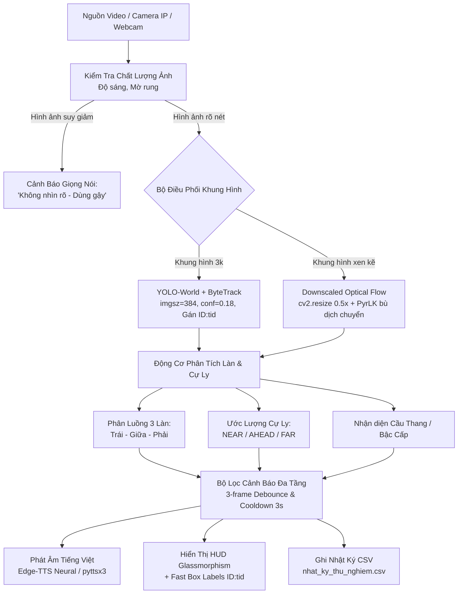

# 🦯 Trợ Lý Thị Giác AI Hỗ Trợ Người Khiếm Thị
### *AI Vision Assistant for the Visually Impaired (2026 Edition)*

[](https://www.python.org/)
[](https://docs.ultralytics.com/models/yolo-world/)
[](https://pytorch.org/)
[](https://opencv.org/)
[](https://github.com/rany2/edge-tts)
[](#bản-quyền--giấy-phép)

---

## 📖 1. Giới Thiệu Dự Án

**Trợ Lý Thị Giác AI** là giải pháp công nghệ thị giác máy tính và học sâu biên (Edge AI) được thiết kế chuyên biệt nhằm đồng hành cùng người khiếm thị trong việc định hướng không gian và phát hiện vật cản khi di chuyển.

Hệ thống kết hợp mô hình nhận diện thế hệ mới **YOLO-World**, thuật toán theo dõi luồng quang học đa tỷ lệ tối ưu hiệu năng **Downscaled Sparse Optical Flow + ByteTrack**, cơ chế kiểm soát chất lượng hình ảnh thời gian thực và hệ thống cảnh báo âm thanh đa tầng bằng tiếng Việt chuẩn tự nhiên.

> [!IMPORTANT]
> **NGUYÊN TẮC AN TOÀN BẮT BUỘC (SAFETY FIRST):**  
> Hệ thống AI được thiết kế đóng vai trò là **công cụ cảnh báo bổ trợ từ xa** nhằm tăng khả năng nhận biết sớm các nguy cơ. Người sử dụng **luôn luôn phải sử dụng kèm gậy dẫn đường (White Cane)** để kiểm tra mặt đất và ranh giới thực tế trước mỗi bước chân. Hệ thống **không bao giờ tự ý chỉ thị người dùng rẽ bước** vào các vùng không gian mà camera chưa xác minh an toàn.

---

## 🚀 2. Tính Năng & Đột Phá Kỹ Thuật

### 👁️ 1. Nhận diện vật thể mở (Open-Vocabulary Detection) với YOLO-World
- Tích hợp mô hình **YOLO-World (v8s)** với bộ phân loại tùy biến 23 lớp đối tượng thực tế thường gặp trong đời sống, học đường và đường phố:
  `cabinet`, `electric box`, `obstacle`, `barrier`, `fence`, `box`, `barrel`, `sign`, `person`, `vehicle`, `wall`, `pillar`, `chair`, `table`, `desk`, `door`, `stairs`, `steps`, `backpack`, `trash can`, `utility pole`, `electric pole`, `streetlight pole`.
- **Kích thước suy luận tối ưu (`INFER_SIZE = 384`)**: Cân bằng tối đa giữa tốc độ xử lý khung hình (FPS) và độ chính xác (có thể điều chỉnh lên 416/512 nếu cần tăng độ nhạy phát hiện các cột mảnh ở xa).
- **Tối ưu nhận diện vật thể mảnh nguy hiểm**: Thiết lập ngưỡng diện tích riêng biệt (`0.03%` diện tích khung hình) và ngưỡng tin cậy hạ tầng (`0.28`) cho cột điện, cột đèn, trụ bê tông để ngăn chặn tình trạng bỏ sót các vật cản cao, mảnh.
- Đầy đủ bản đồ ngôn ngữ tiếng Việt tự nhiên cho toàn bộ các nhãn vật thể.

### ⚡ 2. Bộ bám vết lai tối ưu CPU (Downscaled SparseFlowTracker + ByteTrack)
- **Chu kỳ suy luận tiết kiệm tài nguyên (`DETECT_EVERY = 3`)**: Chạy suy luận mạng nơ-ron YOLO kết hợp thuật toán **ByteTrack** định kỳ mỗi 3 khung hình (`imgsz=384`, `iou=0.40`, `conf=0.18`), gán mã định danh duy nhất (`Track ID`) cho từng đối tượng.
- **Tối ưu hóa Luồng quang học độ phân giải thấp (`flow_scale = 0.5`)**:
  - Khung hình trung gian được thu nhỏ tỷ lệ 50% bằng phép nội suy `INTER_AREA` trước khi tính toán `cv2.calcOpticalFlowPyrLK`.
  - Giảm mạnh tải tính toán CPU, cho phép bám vết mượt mà với độ trễ thấp ngay cả trên máy tính không có GPU rời.
  - Tọa độ dịch chuyển sau đó được bù lại tỷ lệ gốc và giới hạn dịch chuyển cực đại (`clip [-30, 30]`).
- **Giới hạn thời gian sống của vết (`MAX_TRACK_AGE = 0.7s`)**: Tự động loại bỏ các dấu vết cũ khi mất dấu, triệt tiêu hiện tượng vết ma (hallucination).
- **Vẽ nhãn siêu tốc bằng OpenCV**: Sử dụng trực tiếp `cv2.putText` hiển thị tên lớp, độ tin cậy và mã `ID:{tid}` cho từng bounding box, giảm tối đa thời gian chuyển đổi màu RGB/Pillow trên mỗi đối tượng.

### 🛡️ 3. Kiểm định chất lượng thị giác tự động (Image Quality Assessment)
- Đo lường phương sai toán tử Laplacian (`cv2.Laplacian`) và độ sáng trung bình kênh xám:
  - **Thiếu sáng / Quá tối**: Độ sáng < 40.
  - **Chói sáng / Quá mức**: Độ sáng > 230.
  - **Mờ nhòe / Rung lắc**: Điểm số độ sắc nét < 60.
- Lập tức chuyển giao diện sang chế độ cảnh báo màu vàng cam và thông báo giọng nói: *"Không nhìn rõ, hãy cẩn thận. Luôn dùng gậy dò đường."*

### 🛣️ 4. Phân làn 3 hành lang & Ước lượng cự ly tương đối
- Phân chia góc nhìn thành 3 luồng di chuyển: **Làn Trái**, **Làn Giữa (Hướng đi chính)**, và **Làn Phải**.
- Đánh giá cự ly dựa trên vị trí tiếp xúc mặt đất của vật cản (`foot_ratio = y2 / frame_height`):
  - **`NEAR`** (`y2 >= 82%` chiều cao ảnh): Vật cản ở cự ly rất gần, sát chân.
  - **`AHEAD`** (`58% <= y2 < 82%`): Vật cản nằm ngay phía trước mặt.
  - **`FAR`** (`y2 < 58%`): Vật cản ở cự ly xa hơn.
- Phân tích trạng thái thông thoáng của làn giữa, đồng thời quan sát sự xuất hiện của chướng ngại vật ở 2 bên sườn.

### 🎙️ 5. Cảnh báo giọng nói tiếng Việt thông minh (Debouncing & Natural TTS)
- **Bộ lọc ổn định 3 khung hình (Debounce Filter)**: Chỉ kích hoạt cảnh báo khi tình trạng nguy hiểm duy trì liên tục từ 3 khung hình suy luận trở lên (`stable_alert_frames >= 3`), loại bỏ triệt để báo động giả do giật hình.
- **Cơ chế leo thang cấp độ (Escalation Logic)**: Chỉ phát âm khi xuất hiện nguy cơ mới hoặc khi mức độ nguy hiểm tăng lên (từ `FAR` lên `AHEAD` / `NEAR`). Không lặp lại cảnh báo cũ theo chu kỳ cố định gây ồn ào.
- **Hệ thống TTS kép**:
  - Ưu tiên sử dụng **Microsoft Edge TTS** giọng đọc truyền cảm `vi-VN-HoaiMyNeural` chất lượng cao.
  - Tự động chuyển đổi mượt mà sang **pyttsx3 Offline** khi mất kết nối Internet.

### 🖥️ 6. Giao diện hiển thị Glassmorphism HUD hiện đại
- Được xây dựng bằng kỹ thuật vẽ bán trong suốt RGBA đơn lượt qua **Pillow**, hỗ trợ font chữ Unicode tiếng Việt chuẩn xác (`Arial`, `DejaVuSans`).
- Bảng điều khiển gồm:
  - Thanh tiêu đề trạng thái chính (CẢNH BÁO VẬT CẢN / CẦN KIỂM TRA / ĐANG QUAN SÁT).
  - 3 Thẻ hiển thị trạng thái từng làn (Trái - Giữa - Phải) có chấm trạng thái đổi màu.
  - Thẻ thông tin ước lượng cự ly và chỉ dẫn an toàn đặt ở đáy màn hình không che khuất tầm nhìn vật thể ở giữa.
  - Bộ đo thời gian thực FPS (chỉ số trung bình trượt EMA) và thời gian xử lý phần cứng (ms).

### 📊 7. Hệ thống ghi nhật ký & Đánh giá thực nghiệm KHKT chuẩn khoa học
- Lưu trữ toàn bộ kết quả vào tệp tin CSV `nhat_ky_thu_nghiem.csv`.
- Hỗ trợ phím nóng trên bàn phím để người kiểm nghiệm đánh giá nhanh độ chính xác ngay trong quá trình thực địa:
  - Đánh giá: **Đúng (True Positive)** / **Báo nhầm (False Positive)** / **Bỏ sót (False Negative)**.
  - Thống kê tỷ lệ phần trăm tự động phục vụ nghiên cứu và viết báo cáo khoa học kỹ thuật.

---

## 🏗️ 3. Sơ Đồ Kiến Trúc Hệ Thống



---

## 📦 4. Yêu Cầu Cài Đặt & Môi Trường

### 1. Yêu cầu hệ thống
- **Hệ điều hành**: Windows 10/11, Ubuntu 20.04/22.04 LTS, macOS.
- **Python**: Phiên bản `3.9`, `3.10` hoặc `3.11`.
- **Phần cứng**:
  - Tối thiểu: CPU Core i5 / Ryzen 5 thế hệ 8 trở lên (tối ưu hóa luồng quang học 0.5x cho phép chạy ổn định).
  - Tối ưu: Card đồ họa NVIDIA hỗ trợ CUDA để đạt trên 30–60 FPS thời gian thực.

### 2. Cài đặt các thư viện cần thiết

Tạo môi trường ảo (khuyến nghị) và cài đặt:

```bash
# Tạo môi trường ảo Python
python -m venv venv

# Kích hoạt môi trường (trên Windows)
.\venv\Scripts\activate

# Kích hoạt môi trường (trên Linux/macOS)
source venv/bin/activate

# Cài đặt qua requirements.txt
pip install -r requirements.txt
```

*(Nội dung file `requirements.txt` bao gồm: `ultralytics`, `torch`, `torchvision`, `opencv-python`, `pillow`, `edge-tts`, `pygame`, `pyttsx3`, `numpy`)*

### 3. Tải trọng số mô hình YOLO-World
Khi khởi chạy lần đầu tiên, thư viện `ultralytics` sẽ tự động tải trọng số `yolov8s-world.pt`. Nếu muốn tải thủ công trước:
- Tải từ GitHub chính thức của Ultralytics: [yolov8s-world.pt](https://github.com/ultralytics/assets/releases/download/v8.2.0/yolov8s-world.pt)
- Đặt tệp `yolov8s-world.pt` cùng thư mục với mã nguồn chương trình.

---

## 🕹️ 5. Hướng Dẫn Sử Dụng

### Khởi chạy chương trình

```bash
python vision_assistant.py
```

### Cấu hình nguồn phát hình ảnh

Trong mã nguồn, bạn có thể linh hoạt cấu hình biến `camera_src`:
1. **Camera IP từ điện thoại**: Cài đặt ứng dụng **IP Webcam** (Android) hoặc tương đương, kết nối cùng mạng Wi-Fi và điền đường dẫn URL:
   ```python
   camera_src = "http://192.168.1.42:8080/video"
   ```
2. **Webcam máy tính**: Nếu camera IP mất tín hiệu hoặc không tìm thấy, chương trình sẽ tự động chuyển sang Webcam máy tính (cổng số `0`).
3. **Thử nghiệm qua tệp video hoặc ảnh tĩnh**: Nhấn phím `V` hoặc `P` trên giao diện để mở cửa sổ chọn tệp tin.

---

## ⌨️ 6. Bảng Phím Tắt Điều Khiển & Đánh Giá Thực Địa

Giao diện cửa sổ trực tiếp hỗ trợ các phím thao tác một chạm:

| Phím Tắt | Chức Năng | Mục Đích Sử Dụng |
| :---: | :--- | :--- |
| **`1`** | Đánh giá **ĐÚNG** | Ghi nhận mô hình nhận diện chính xác vật cản thực tế vào nhật ký. |
| **`2`** | Đánh giá **BÁO NHẦM** | Ghi nhận tình huống báo động giả (không có vật cản mà báo). |
| **`3`** | Đánh giá **BỎ SÓT** | Ghi nhận tình huống có vật thể nguy hiểm nhưng mô hình không phát hiện. |
| **`T`** | **Ghi Nhật Ký** nhanh | Lưu lại hiện trạng tức thời của khung hình vào tệp CSV. |
| **`C`** | **Đổi Tình Huống** | Luân chuyển ngữ cảnh thử nghiệm: `Hành lang` ➔ `Lớp học` ➔ `Cầu thang`. |
| **`S`** | **Đọc Tóm Tắt** | Yêu cầu trợ lý đọc to danh sách các vật thể đang quan sát thấy trước mặt. |
| **`V`** | **Nạp Video Test** | Mở hộp thoại chọn tệp video (`.mp4`, `.avi`, `.mov`, `.mkv`) để chạy kiểm thử. |
| **`P`** | **Nạp Ảnh Test** | Mở hộp thoại chọn ảnh tĩnh (`.jpg`, `.png`, `.webp`) để kiểm tra nhận diện. |
| **`Q`** / **`ESC`** | **Thoát** | Dừng chương trình và giải phóng tài nguyên camera, âm thanh. |

---

## 📑 7. Cấu Trúc Nhật Ký Kiểm Thử (`nhat_ky_thu_nghiem.csv`)

Dữ liệu thử nghiệm thực địa được lưu trữ tự động theo chuẩn bảng mã UTF-8 có BOM (tương thích mở ngay trên Microsoft Excel không bị lỗi phông tiếng Việt):

| Tên Cột | Ý Nghĩa Dữ Liệu | Ví Dụ Minh Họa |
| :--- | :--- | :--- |
| `ThoiGian` | Thời điểm ghi nhận (YYYY-MM-DD HH:MM:SS) | `2026-10-17 12:30:15` |
| `TinhHuong` | Ngữ cảnh thực nghiệm | `Hành lang`, `Lớp học`, `Cầu thang` |
| `NguonHinhAnh` | Nguồn dữ liệu kiểm thử | `Webcam/IP`, `test_hallway.mp4` |
| `ChatLuongAnh` | Tình trạng ánh sáng và độ nét | `Rõ nét`, `Quá tối (35.2)`, `Mờ rung (48.1)` |
| `LanTrai` | Trạng thái hành lang bên trái | `Thoáng` / `Chặn` |
| `LanGiua` | Trạng thái hành lang chính giữa | `Thoáng` / `Chặn` |
| `LanPhai` | Trạng thái hành lang bên phải | `Thoáng` / `Chặn` |
| `CuLyGiua` | Vùng cự ly ước tính của vật cản trung tâm | `NEAR`, `AHEAD`, `FAR`, `Thông thoáng` |
| `CanhBaoAmThanh` | Nội dung câu cảnh báo đã phát thanh | *"Cẩn thận, có vật cản trước mặt trên đường đi..."* |
| `DanhGiaThucTe` | Nhãn đánh giá của chuyên gia/người dùng | `Đúng`, `Báo nhầm`, `Bỏ sót`, `Chưa đánh giá` |

---

## 📁 8. Cấu Trúc Thư Mục Dự Án

```
├── vision_assistant.py        # Mã nguồn chính của ứng dụng (phiên bản tối ưu 2026)
├── yolov8s-world.pt          # Trọng số mô hình YOLO-World v8s
├── requirements.txt          # Danh sách thư viện Python cần thiết
├── nhat_ky_thu_nghiem.csv    # Nhật ký lưu trữ kết quả thực nghiệm tự động
└── README.md                 # Tài liệu hướng dẫn sử dụng và đặc tả kỹ thuật
```

---

## ⚖️ 9. Tuyên Bố Trách Nhiệm & Bản Quyền

- Dự án được phát triển nhằm mục đích **nghiên cứu khoa học, giáo dục và phục vụ cộng đồng**, đặc biệt là hỗ trợ người yếu thế và người khiếm thị nâng cao chất lượng cuộc sống.
- Thiết bị và thuật toán AI mang tính chất trợ giúp định hướng; không thể thay thế năng lực định hướng tự thân, các khóa huấn luyện định hướng di chuyển (O&M) và gậy dò đường tiêu chuẩn.
- Phát hành theo giấy phép **MIT License**. Tự do sử dụng, chỉnh sửa và tích hợp phi thương mại.
